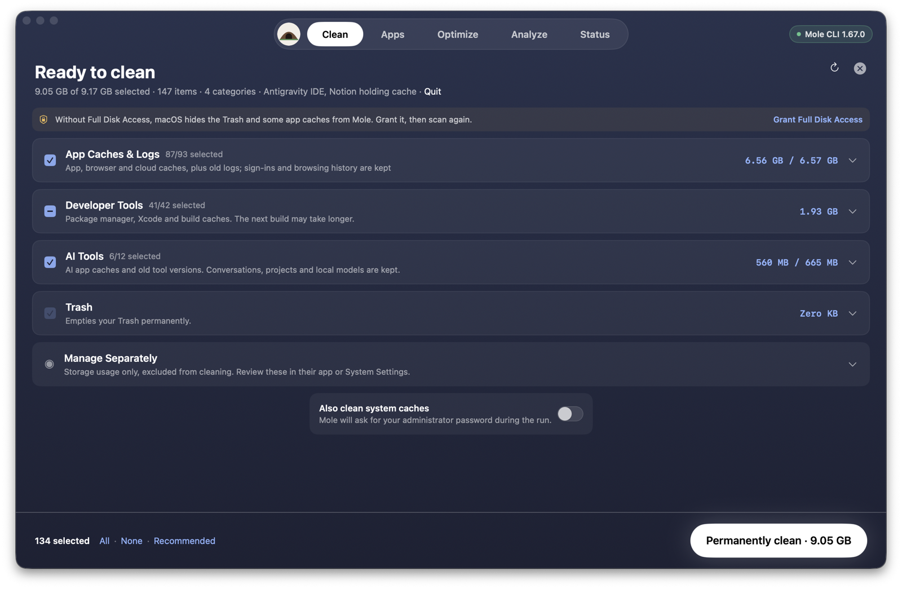
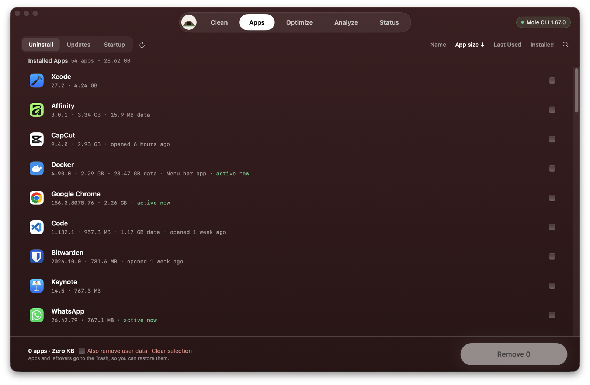

<div align="center">
  <h1>Burrow</h1>
  <p><b>A native macOS app for the open-source Mole cleanup CLI.</b><br>
  Clean caches, uninstall apps with their leftovers, run maintenance, explore disk usage and watch system health, all in one window.</p>
  <p>
    
    
    
    
  </p>
</div>



Burrow is a graphical front end for [Mole](https://github.com/tw93/Mole), a
safety-first macOS maintenance CLI. Burrow does not reimplement Mole's cleanup
logic in Swift. Every scan, cleanup, uninstall, optimization, disk analysis and
health reading runs the same `mole` shell scripts and Go helpers you would run in
Terminal. They ship inside the app, so nothing else needs to be installed.

What Burrow adds is the window around them: reviewable lists with checkboxes,
plain-language explanations, sensible default selections, live progress, and a
native password prompt when Mole needs administrator rights.

> Burrow is an independent fork. It is **not affiliated with or endorsed by** the
> Mole project or Mole for Mac. See [Name and trademark](#name-and-trademark).

---

## Contents

- [Features](#features)
- [Install](#install)
- [First launch: two macOS permissions](#first-launch-two-macos-permissions)
- [Using Burrow](#using-burrow)
- [Safety model](#safety-model)
- [How it works](#how-it-works)
- [Build from source](#build-from-source)
- [Project layout](#project-layout)
- [Troubleshooting](#troubleshooting)
- [FAQ](#faq)
- [Known limitations](#known-limitations)
- [Name and trademark](#name-and-trademark)
- [License and credits](#license-and-credits)

---

## Features

| Tab | What you get |
|---|---|
| **Clean** | A preview scan of caches, logs, browser data, developer caches, AI-tool caches, leftovers and Trash, grouped into named rows by category. Recommended selection, per-item checkboxes, a permanent "protect" shield, Show in Finder, and an optional system-cache pass that asks for your password. |
| **Apps › Uninstall** | Every installed app with version, size, data size, last opened and "active now". Expand an app to see exactly what will be removed: Mole's plan plus extra leftovers Burrow finds from the app's own bundle evidence. Apps go to the Trash. |
| **Apps › Updates** | Outdated Homebrew apps and formulae, with one-click upgrade. |
| **Apps › Startup** | Your launch agents and daemons, with on/off switches. |
| **Optimize** | Mole's list of bounded maintenance tasks and its performance notes, then a live, step-by-step run. |
| **Analyze** | A clickable treemap of what uses your disk, a breadcrumb path, a Largest Files list, and right-click Copy Path / Show in Finder / Move to Trash. |
| **Status** | Live cards for health score, CPU, GPU, memory, battery, disk, network and thermals, with sparklines, plus a process list where you can quit or force-quit apps. |

Keyboard: <kbd>⌘1</kbd>–<kbd>⌘5</kbd> switch tabs.



---

## Install

### From a release DMG

1. Download `Burrow-<version>.dmg` from this repository's
   [Releases](https://github.com/thilinanamal/Burrow/releases) page, if one is published. Otherwise
   [build it yourself](#build-from-source); it takes a few minutes.
2. Open the DMG and drag **Burrow** into **Applications**.
3. Open Burrow, then continue with the next section.

### Requirements

- macOS 14 Sonoma or later.
- Apple Silicon or Intel. A build runs on the processor type of the Mac that built it.
- Optional: [Homebrew](https://brew.sh) for the Updates tab and for Mole's
  Homebrew cleanup step.

---

## First launch: two macOS permissions

### 1. Allow the app to open

Burrow is **ad-hoc signed**: it is built without a paid Apple Developer account
and is not notarized. The first time you open it, macOS refuses:

1. Open Burrow once and dismiss the warning.
2. Go to **System Settings › Privacy & Security**.
3. Scroll down to the message about Burrow and click **Open Anyway**, then confirm.

You only do this once per installed copy.

### 2. Grant Full Disk Access (strongly recommended)

macOS hides some folders from apps unless you allow it. These include the
Trash, browser profile data, Mail and Messages caches, and other apps'
containers. Mole runs as part of Burrow, so it inherits the same restriction.
Without the permission, scans find much less.

> On the author's Mac, the same scan found about **9 GB without** Full Disk
> Access and about **26 GB with** it. The Trash and every Chrome profile cache
> were invisible without it.

1. Click **Grant Full Disk Access** in the banner on the Clean screen, or open
   **System Settings › Privacy & Security › Full Disk Access**.
2. Turn on **Burrow**. If it is not listed, click **+** and pick it from Applications.
3. Return to Burrow and scan again.

Because the app is ad-hoc signed, macOS ties this permission to that exact
build. **After installing a rebuilt copy, check the switch again.**

---

## Using Burrow

### Clean

1. Click **Scan your Mac**. The scan is read-only (`mo clean --dry-run`); nothing is deleted.
2. Review **Ready to clean**. Rows are grouped into:
   - **App Caches & Logs**: app, browser and cloud caches plus old logs. Sign-ins and browsing history are kept.
   - **Developer Tools**: package-manager, Xcode and build caches, and build output in your projects.
   - **AI Tools**: caches of AI apps and coding tools. Conversations, projects and local models are kept.
   - **Uninstalled App Leftovers**: data from apps no longer on the Mac.
   - **System Data**: system caches and logs. Needs your administrator password.
   - **Trash**: emptied as a whole, permanently.
   - **Manage Separately**: storage Mole reports but does not clean, for example Docker data. Review it in the owning app.
3. Adjust the selection:
   - **Recommended** (the default) leaves out:
     - **In use** rows (locked): data an app is using right now. The header shows
       "*App, App* holding cache · **Quit**". Quitting those apps unlocks the rows.
     - **Review** rows: anything that would have to download again (npx, Dart,
       Go modules, Bun and similar), build output in your own projects, old
       Homebrew versions, caches that may hold offline media, and leftovers of
       deleted apps. Each row says why it was not selected.
     - The **Trash**.
   - **All**, **None**, or individual checkboxes.
   - The **shield** protects an item permanently. It is added to Mole's whitelist,
     the same as `mo clean --whitelist`.
4. Optionally turn on **Also clean system caches**. Burrow shows a native password prompt when Mole asks.
5. Click **Permanently clean**. Progress streams live, and a summary shows what
   was removed, skipped or failed, read from Mole's own operation history.

> Cleaned items are **deleted, not moved to the Trash**. That is Mole's design
> for rebuildable caches. Review before you click.

### Apps › Uninstall

- Sort by name, app size, last used or install date, and search by name.
- Tick apps, or click a row to expand its removal plan:
  - **Ready to remove**: the app bundle, plus caches, logs, saved state and recent-file records.
  - **Needs review**: settings, containers, support folders, `~/.<app>` folders
    and command-line tools linked into the app, unchecked by default.
    **Select all** includes them.
- **Also remove user data** passes `--with-data` to Mole for its personal-data rows.
- Running apps are detected; Burrow offers to quit them before removal.
- Apps and every leftover go to the **Trash**, so you can restore them. Items
  that need administrator rights, such as links in `/usr/local/bin`, are listed
  for you to remove in Finder.

### Apps › Updates and Startup

Mole deliberately does not update apps or manage login items. These two tabs
are Burrow additions:

- **Updates** uses `brew outdated --greedy-auto-updates` and `brew upgrade`.
- **Startup** lists plists in `~/Library/LaunchAgents`, `/Library/LaunchAgents`
  and `/Library/LaunchDaemons`. Your own agents toggle with `launchctl`; system
  daemons ask for your password through macOS.

### Optimize

Shows Mole's maintenance tasks and its performance diagnosis, such as swap use
or a full disk. **Optimize** runs them with live step-by-step progress.

### Analyze

Pick a location, then click tiles in the treemap to drill in, or use the
breadcrumbs to go back. The sidebar switches between the current folder and
the largest files. Right-click an item for Copy Path, Show in Finder or Move
to Trash (with confirmation). The first scan of a big folder can take a
minute; later views are cached.

### Status

Refreshes every two seconds from `mo status --watch`. Cards turn amber or red
when something needs attention. The process table can quit or force-quit an
app after confirmation.

---

## Safety model

Burrow keeps Mole's safety rules and adds none that widen what gets deleted.

- **Mole decides what to clean.** The clean review is built from Mole's own
  dry-run and the exact candidate list it writes to
  `~/.config/mole/clean-list.txt`. Burrow only groups and labels those paths.
- **Unchecking is enforced through Mole's whitelist.** Unchecked rows are
  written to a clearly marked temporary block in `~/.config/mole/whitelist` for
  that run only. The block is removed when the run ends, and again at every
  launch in case the app was killed. If the whitelist file did not exist,
  Burrow seeds it with Mole's default protections, so nothing loses protection.
  Owner-command cleanups (for example `npm cache clean`) are whitelisted by
  their tool root.
- **Extra uninstall leftovers need exact evidence.** Burrow matches only:
  - bundle IDs of the app and the helper apps inside it;
  - folders named exactly after the app's own bundle names;
  - preference and recent-file names that are those exact IDs followed by a
    known file suffix;
  - command-line links that resolve into the app bundle.

  It never matches by vendor prefix or partial name, never claims a name another
  installed app also uses, and anything holding settings or data starts unchecked.
  Extras move to the Trash, and only after Mole has removed the app.
- **Your password is never stored.** It is written once to Mole's `sudo`
  prompt in the hidden terminal and then discarded.
- **Every Mole action is logged** in Mole's operation log, viewable with `mo history`.
- **Nothing runs in the background.** No agents, daemons, menu-bar helper or telemetry.

---

## How it works

```
┌────────────── Burrow.app (SwiftUI) ──────────────┐
│  Views  ─▶  Models / parsers  ─▶  CLI runners    │
│                                     │            │
│     read-only: pipes ───────────────┤            │
│     actions:   pseudo-terminal ─────┤            │
└─────────────────────────────────────┼────────────┘
                                      ▼
          Contents/Resources/mole/  (bundled Mole CLI)
          mole · bin/*.sh · lib/** · bin/analyze-go · bin/status-go
```

| Tab | Mole / system surface used |
|---|---|
| Clean | `mo clean --dry-run` + `~/.config/mole/clean-list.txt`, then `mo clean` |
| Apps › Uninstall | `mo uninstall --list`, `mo uninstall --dry-run <app>`, `mo uninstall [--with-data] <apps>` |
| Apps › Updates | `brew outdated --json=v2 --greedy-auto-updates`, `brew upgrade` |
| Apps › Startup | launchd plists, `launchctl enable/disable/bootstrap/bootout` |
| Optimize | `mo optimize --dry-run`, then `mo optimize` |
| Analyze | `mo analyze --json [path]`; Trash via Finder |
| Status | `mo status --json --watch --interval 2s` (NDJSON stream) |
| Results | `mo history --json` |

**Why a hidden terminal?** Mole accepts confirmations and `sudo` passwords
only from a real terminal. For actions, Burrow starts the CLI under a
pseudo-terminal (`forkpty`). It answers the "Enter to confirm" prompt that you
already answered in the window, sends Space to skip system caches when you left
that switch off, and turns `Password:` prompts into a native sheet. If the CLI
waits on a prompt Burrow does not recognize, the window offers Enter and Cancel
buttons after 20 seconds.

---

## Build from source

Requirements: macOS 14+, Xcode Command Line Tools (Swift 5.10+), and
[Go](https://go.dev) for Mole's `analyze` and `status` helpers.

```bash
git clone https://github.com/thilinanamal/Burrow.git
cd Burrow
app/scripts/build.sh                      # app/dist/Burrow.app + app/dist/Burrow-1.0.0.dmg
app/scripts/build.sh --no-dmg             # app only
BURROW_VERSION=1.1.0 app/scripts/build.sh # set the app version
```

The script:

1. Builds Mole's Go helpers (`make build`).
2. Builds Burrow in release mode with SwiftPM.
3. Copies `mole`, `mo`, `bin/`, `lib/` and `LICENSE` into `Contents/Resources/mole`.
4. Renders the icon and writes `Info.plist`.
5. Ad-hoc signs the helpers, the binary and the bundle, then verifies the signature.
6. Creates a drag-to-install DMG with an Applications link and a "READ ME FIRST" note.

### Development run

```bash
cd app
swift build
BURROW_MOLE_PATH="$PWD/../mole" .build/debug/Burrow
```

| Variable | Effect |
|---|---|
| `BURROW_MOLE_PATH` | Use this `mole` script instead of the bundled one. |
| `BURROW_TAB` | Start tab: `clean`, `apps`, `optimize`, `analyze`, `status`. |
| `BURROW_AUTOSCAN=1` | Start a read-only clean preview at launch (QA and screenshots). |

Debug builds use noticeably more CPU, mostly for the animated planets. Judge
performance on a release build.

### Testing the CLI side

The Mole CLI keeps its own test suite. Run it from the repository root:

```bash
MOLE_TEST_NO_AUTH=1 ./scripts/test.sh
MOLE_TEST_NO_AUTH=1 ./mole clean --dry-run
```

---

## Project layout

```
app/
├── Package.swift                 SwiftPM manifest (macOS 14, one executable target)
├── scripts/
│   ├── build.sh                  release build, bundle, sign, DMG
│   └── make-icon.swift           renders the app icon
├── docs/screenshots/
└── Sources/Burrow/
    ├── BurrowApp.swift           app entry, window, menu, app-wide model
    ├── CLI/
    │   ├── MoleCLI.swift         locate and run the bundled CLI (pipes, streams)
    │   ├── PTYSession.swift      forkpty-based pseudo-terminal
    │   ├── CLIJob.swift          long-running actions, prompt responders, password flow
    │   └── ANSI.swift            escape stripping, terminal transcript
    ├── Models/
    │   ├── CleanPreview.swift    dry-run + candidate-list parser
    │   ├── CleanGrouping.swift   row grouping, names, review and in-use rules, Full Disk Access check
    │   ├── Whitelist.swift       temporary and permanent whitelist edits
    │   ├── AppModels.swift       app list, details, uninstall plan parser
    │   ├── LeftoverScanner.swift evidence-based extra leftovers
    │   ├── AnalyzeResult.swift · StatusSnapshot.swift · History.swift
    ├── Support/                  formatting, theme, shared styles
    └── Views/                    one file per tab plus shared screens and planet art
```

Everything outside `app/` (plus [FORK_NOTICE.md](FORK_NOTICE.md) and this
README) is upstream Mole, unmodified. Mole's original README is kept as
[README_MOLE.md](README_MOLE.md).

---

## Troubleshooting

| Problem | Fix |
|---|---|
| "Burrow can't be opened" / "cannot verify the developer" | System Settings › Privacy & Security › **Open Anyway**. |
| Trash shows *Zero KB*, or scans look small | Grant **Full Disk Access**, then scan again. After a rebuild, toggle it off and on. |
| Rows marked **In use** cannot be selected | The app owning that data is running. Use **Quit** in the header, or quit it yourself; rows unlock automatically. |
| A run seems stuck | After 20 seconds of silence on a prompt, Enter and Cancel buttons appear. Open the log disclosure to see Mole's output. |
| Analyze is slow the first time | Mole is measuring a cold folder. Later visits come from its cache. |
| An extra uninstall leftover was not removed | It needs administrator rights (for example `/usr/local/bin`). The result note lists it; remove it in Finder. |
| A protected path should be cleaned again | Remove it with the shield button, or edit `~/.config/mole/whitelist`. |

Mole's logs live in `~/Library/Logs/mole/`. `mo history` shows every recorded action.

---

## FAQ

**Is this Mole for Mac?**
No. Mole for Mac (https://mole.fit) is a separate, paid, closed-source app by
Mole's author. Burrow is an independent, open-source GUI over the free Mole
CLI. Some layout ideas are similar; the code, name, icon and artwork are not.

**Does Burrow delete anything Mole would not?**
Clean and Optimize: no. Burrow can only remove fewer items, through the
whitelist. Uninstall: Burrow can additionally move evidence-matched leftovers
to the **Trash**, where you can restore them.

**Why is it not notarized?**
Notarization needs a paid Apple Developer account. The build script signs
ad-hoc so anyone can build and run it.

**Can I use my own Mole install instead of the bundled one?**
Yes. Set `BURROW_MOLE_PATH` to a `mole` script.

**Does Burrow phone home?**
No. It has no network code of its own. The only network activity comes from
tools you trigger, such as Homebrew in the Updates tab.

---

## Known limitations

- Category sizes come from Mole's per-path estimates and may differ slightly from Mole's final "Removed" total.
- Cleanups that run a tool's own command (Homebrew, npm, Go, pip) follow the tool's root. Unchecking one subfolder of such a tool can skip that whole tool's step.
- The Trash is emptied all at once. Unchecking any Trash item keeps the whole Trash.
- Mole's own personal-data rows in an uninstall plan follow a single switch (`--with-data`) for all selected apps.
- No menu-bar display, fan control or scheduled cleaning, by design. Mole is a no-background-agents tool.
- The app list contains what `mo uninstall --list` reports. System apps and web-app shims are not shown.

---

## Name and trademark

"Mole" and the Mole logo are trademarks of the Mole project. GPL-3.0 covers the
code, not the brand ([TRADEMARK.md](TRADEMARK.md)). This fork therefore uses its
own name, **Burrow**, its own icon and procedurally generated artwork, and does
not claim endorsement by or affiliation with Mole or Mole for Mac.

---

## License and credits

- **License:** GNU General Public License v3.0, the same as upstream. See
  [LICENSE](LICENSE). Anyone who receives a built copy of Burrow is entitled to
  this complete source code.
- **Changes from upstream:** listed in [FORK_NOTICE.md](FORK_NOTICE.md).
- **Mole CLI:** © tw93 and contributors, https://github.com/tw93/Mole. All
  cleanup, uninstall, optimization, analysis and status logic in Burrow comes
  from Mole, bundled unmodified in `Contents/Resources/mole`.
- **Burrow app:** the SwiftUI wrapper in `app/`.
